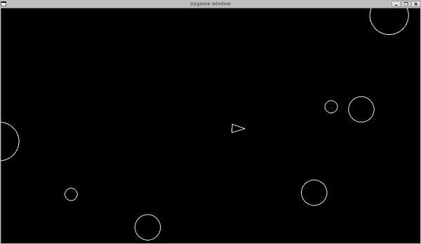

# Asteroids

A small Asteroids-style game built with Python and Pygame as a Boot.dev learning project.



## Controls

- **W / S**: Move forward and backward
- **A / D**: Rotate
- **Space**: Shoot

## Gameplay

- Avoid asteroids; colliding with one ends the game.
- Shoot larger asteroids to split them into two smaller ones.

## Run locally

Requires Python 3.13 or newer and [uv](https://docs.astral.sh/uv/).

```bash
uv sync
uv run main.py
```
